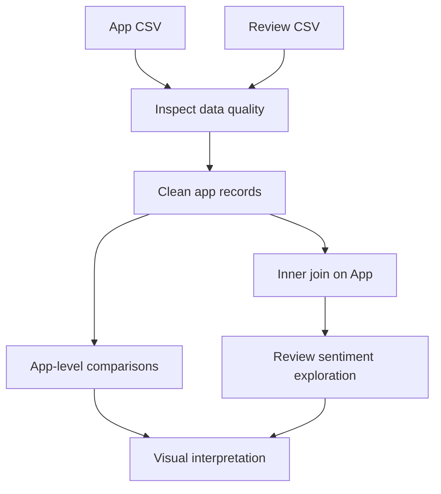

<div align="center">

# Play Store App Review Analysis

### Exploring app performance and user feedback with Python


**Exploratory Data Analysis · Data Cleaning · Statistical Visualization**

**Swapnil Sudhakar Pathare** | Individual capstone project

[Explore the Notebook](capstone_second_project_of_playstore_app_Review_Analysis.ipynb)

</div>

---

## About the Project

What separates a widely installed app from a highly rated one? How do app categories, pricing and review sentiment compare?

This project uses **Exploratory Data Analysis (EDA)** to explore Play Store app information alongside user-review data. The Python notebook cleans numeric fields, investigates missing values and duplicates, combines app and review records, and builds visualizations to examine app popularity and user feedback.

The goal is to make patterns easier to understand and support further investigation into app quality, engagement and category performance.

## Questions Explored

- How are app ratings, installs and prices distributed?
- Which categories and genres contain the most app records?
- Which categories and apps have the highest installation totals?
- How do free and paid apps compare in count and average rating?
- How are positive, neutral and negative review labels distributed?
- What relationships appear among ratings, installs, reviews and price?

## Tech Stack

| Tool | Purpose |
| --- | --- |
| **Python** | Analysis and data-processing logic |
| **pandas** | Load CSVs, inspect data, clean columns, group records and merge tables |
| **NumPy** | Numerical computing library imported by the notebook |
| **Matplotlib** | Plot creation, titles, axes and figure styling |
| **Seaborn** | Statistical plots, distributions, heatmaps and pair plots |
| **Jupyter / Google Colab** | Run the analysis interactively |
| **File formats** | `.ipynb` notebook and `.csv` input datasets |

## Data Sources

The notebook expects two course datasets:

| Input file | Information used in the analysis |
| --- | --- |
| `Play Store Data.csv` | App name, category, rating, review count, installs, free/paid type, price and genres |
| `User Reviews.csv` | App identifiers, existing sentiment labels and sentiment polarity values |

**Course context:** AlmaBetter learning materials. The CSV files are not included in this repository; obtain them from your authorized course resources before running the notebook.

The sentiment analysis in the implemented code explores **existing dataset fields**. It does not train a sentiment classifier or generate sentiment labels from review text.

## Analysis Workflow



### Data preparation

The notebook:

1. Inspects dataset shapes, columns, types, missing values and duplicates.
2. Removes exact duplicate rows from the apps table.
3. Removes `+` and commas from installs and converts the values to numeric.
4. Removes the dollar symbol from prices and converts prices and review counts to numeric.
5. Drops app rows containing missing values after conversion.
6. Inner-joins apps and reviews on the `App` column for sentiment exploration.

### Visualization highlights

The notebook contains **20 numbered visualization sections** covering univariate, bivariate and multivariate exploration.

| Analysis area | Examples |
| --- | --- |
| **Distributions** | Ratings, installs, prices and sentiment polarity |
| **Category comparisons** | Average ratings, app counts, top genres and top categories by installs |
| **App comparisons** | Top 10 apps by installs and top 10 by reviews |
| **Free vs. paid** | App-type distribution and average rating by type |
| **Review sentiment** | Counts of existing positive, neutral and negative labels |
| **Relationships** | Rating vs. installs, reviews vs. rating, correlation heatmap and pair plot |

## Example: Exploring Category Popularity

After running the loading and cleaning cells, the following pattern ranks categories by their total installs:

```python
top_categories = (
    apps.groupby("Category")["Installs"]
    .sum()
    .sort_values(ascending=False)
    .head(10)
)

print(top_categories)
```

**How to interpret it:** Compare the installation ranking with category app counts and rating distributions. A category can have many app records without having the highest total installs, and a large installation total does not establish profitability or unique user count.

## Run the Project

### Option 1: Google Colab

1. Download the notebook from this repository.
2. Open Google Colab and choose **File → Upload notebook**.
3. Upload `Play Store Data.csv` and `User Reviews.csv` through the Files panel so they appear under `/content/`.
4. Run the notebook cells from top to bottom.

The existing loading cells use:

```python
apps = pd.read_csv("/content/Play Store Data.csv")
reviews = pd.read_csv("/content/User Reviews.csv")
```

### Option 2: Local Jupyter Notebook

Install the required packages:

```bash
python -m pip install pandas numpy matplotlib seaborn notebook
jupyter notebook
```

Place the two CSV files beside the notebook, then change the loading cells to:

```python
apps = pd.read_csv("Play Store Data.csv")
reviews = pd.read_csv("User Reviews.csv")
```

Open `capstone_second_project_of_playstore_app_Review_Analysis.ipynb` and run the cells in order. No pinned dependency versions or automated environment setup are supplied.

## Repository Contents

| File | Description |
| --- | --- |
| `capstone_second_project_of_playstore_app_Review_Analysis.ipynb` | Main EDA notebook with preprocessing, charts and interpretation |
| `README.md` | Project overview and execution guide |

Source CSVs must be supplied separately. The uploaded project archive contains the notebook only; this README is intended to be added beside it.

## Findings and Interpretation

The notebook's written observations describe ratings concentrated around 4.0–4.5, a predominance of free apps, skewed installation counts and predominantly positive sentiment. It also discusses stronger association between installs and reviews than between popularity metrics and rating.

**These are notebook-reported observations, not independently reproduced results.** The supplied notebook has no saved execution outputs, and the source data was unavailable for verification. Run the analysis before reporting exact counts, percentages or correlation values.

## Current Limitations

- **Chart 16 needs correction:** its heading says “Sentiment vs Rating,” but its code repeats average rating by free/paid type. It does not support the accompanying sentiment-versus-rating conclusion.
- **Missing-value removal affects coverage:** dropping every app row with any missing field can change category representation.
- **Join multiplicity needs review:** exact-row deduplication does not guarantee one row per app. Repeated app names can multiply records in the app–review join.
- **Scope is exploratory:** no implemented text-cleaning pipeline, word-cloud analysis, trained NLP model or time-based feedback analysis is present, despite broader discussion in the notebook narrative.
- **Association is not causation:** the plots do not demonstrate that ratings or sentiment cause changes in downloads, retention or revenue.

## Skills Demonstrated

**Data inspection · Numeric conversion · Missing-value handling · Duplicate detection · pandas joins and aggregation · Exploratory visualization · Correlation analysis · Analytical communication**

---

**Author:** Swapnil Sudhakar Pathare  
**Acknowledgment:** AlmaBetter course learning resources. Respect the original dataset's usage terms when sharing data.
